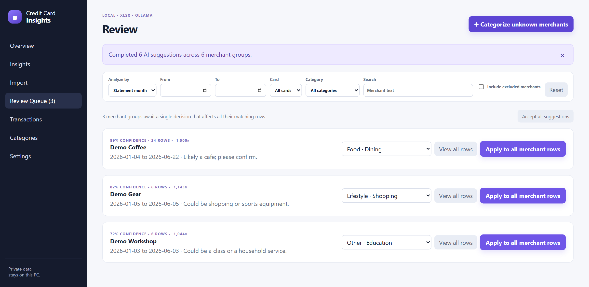
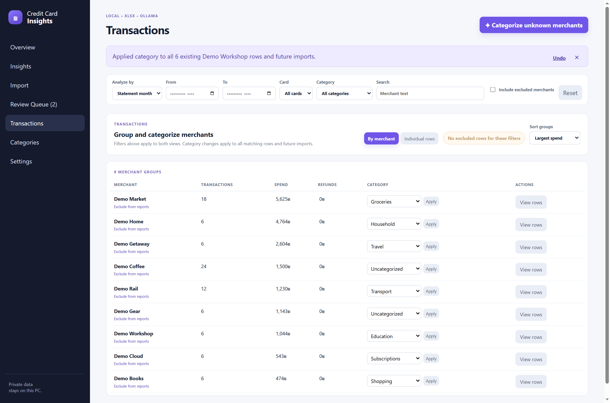
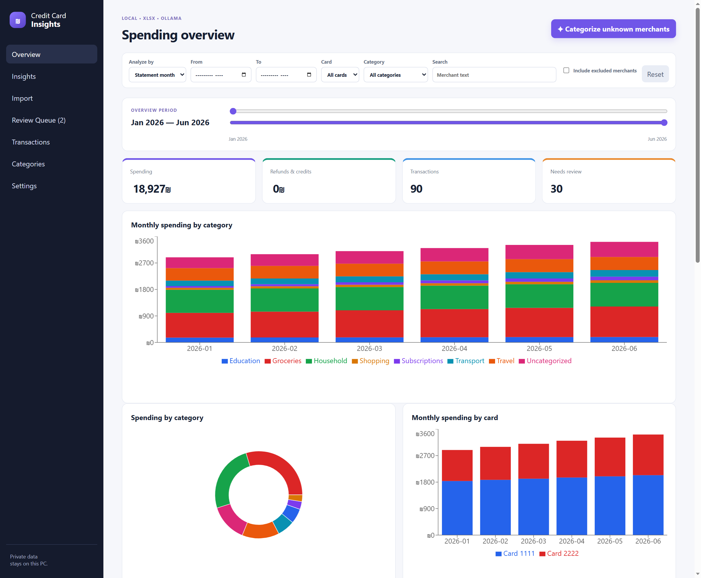
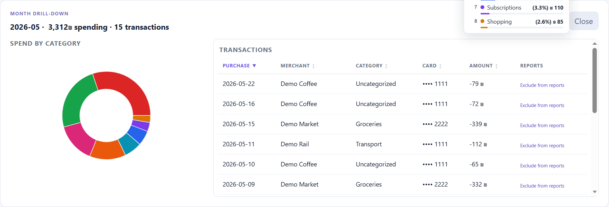
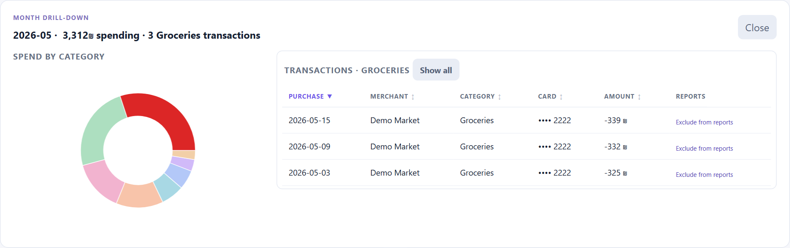

# Credit Card Insights

Private, local analysis for credit-card `.xlsx` statements. It imports supported Hebrew card statements, keeps the data in local SQLite, and categorizes merchants using local Ollama AI.

## See what it does

All screenshots use invented transactions and card endings. AI responses are simulated for the demonstration; the screenshots show the actual app and its categorization workflow.

### Automatic tagging with local AI

Categorize unknown merchants in batches with Ollama. Suggestions at 95% confidence or higher apply automatically; uncertain suggestions go to the review queue, where you can confirm or change the category. Confirmed rules also apply to future imports.



### Tag a merchant once, update every matching transaction

Work through merchant groups by spend or transaction count. Choose a category and press **Apply** to update all matching transactions and future imports. Create categories directly from the picker, inspect individual rows, and undo the last rule change.



### Explore the spending dashboard

Compare monthly spending by category and card, track refunds separately, and narrow the view by date, card, category, or merchant. Switch between statement month and purchase date to answer different questions about your spending.



### Drill down from a month to its transactions

Click a monthly bar to open its category breakdown and transaction table. Click a category slice to narrow the table, sort the columns, or follow a category or merchant from the dashboard into the Transactions view.



Select a category slice to focus on its transactions. **Show all** restores the complete month.



## Run

Install Node.js 22 or 24, then run these commands from the project directory:

```sh
npm ci
npm run dev
```

On Windows PowerShell, use `npm.cmd` if your execution policy blocks `npm`.

Open http://127.0.0.1:3000. The app binds only to this computer and stores its SQLite database plus uploaded statement copies in `data/` (ignored by Git).

## Documentation

- [Using the app](docs/USAGE.md)
- [Overview and drill-downs](docs/OVERVIEW.md)
- [Categorization and merchant rules](docs/CATEGORIZATION.md)
- [Local data, privacy, and backups](docs/DATA_AND_BACKUPS.md)

## Quick start

1. Open **Import**, select one or more statements from your computer, review the parsed counts, and commit. Filenames must follow `NNNN_MM_YYYY.xlsx`, where `NNNN` is the card ending and `MM_YYYY` is the statement month (for example, the synthetic filename `1111_01_2026.xlsx`).
2. Open **Review queue** after batch categorization. Any decision creates a merchant-wide rule: it updates all existing matching rows and future imports.
3. Use **Transactions** to work through merchant groups by largest spend, filter to **Uncategorized** when needed, and change a merchant’s category across all matching rows. Switch to **Individual rows** to inspect and sort the underlying transactions; use the Undo action to reverse the last rule change.

## Local AI

The app sends batches of up to 50 unknown merchant groups to a local Ollama server. It never sends financial data to a cloud provider.

Install the recommended multilingual model once:

```powershell
ollama pull gemma3:4b
```

Then select **Categorize unknown merchants** in the app. Suggestions below 95% confidence enter the review queue; higher-confidence suggestions apply a visible AI rule automatically.

## Sharing the source

The source does not include statements or a populated database. Keep financial data in the ignored `data/` directory or outside the repository. The ignore rules also exclude statement files, database copies, local exports, and environment files. Before sharing code, review the staged files for private content, including any reports or screenshots you create.

This is a local, single-user application without authentication. Keep it bound to localhost when using real financial data.
